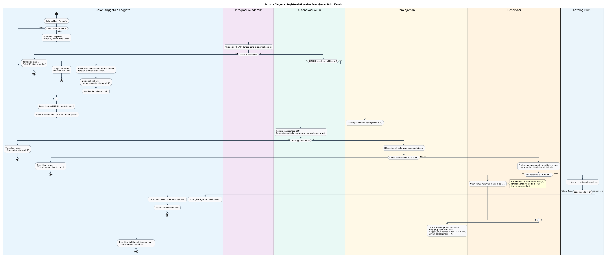
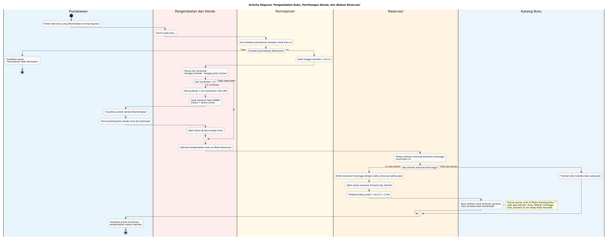
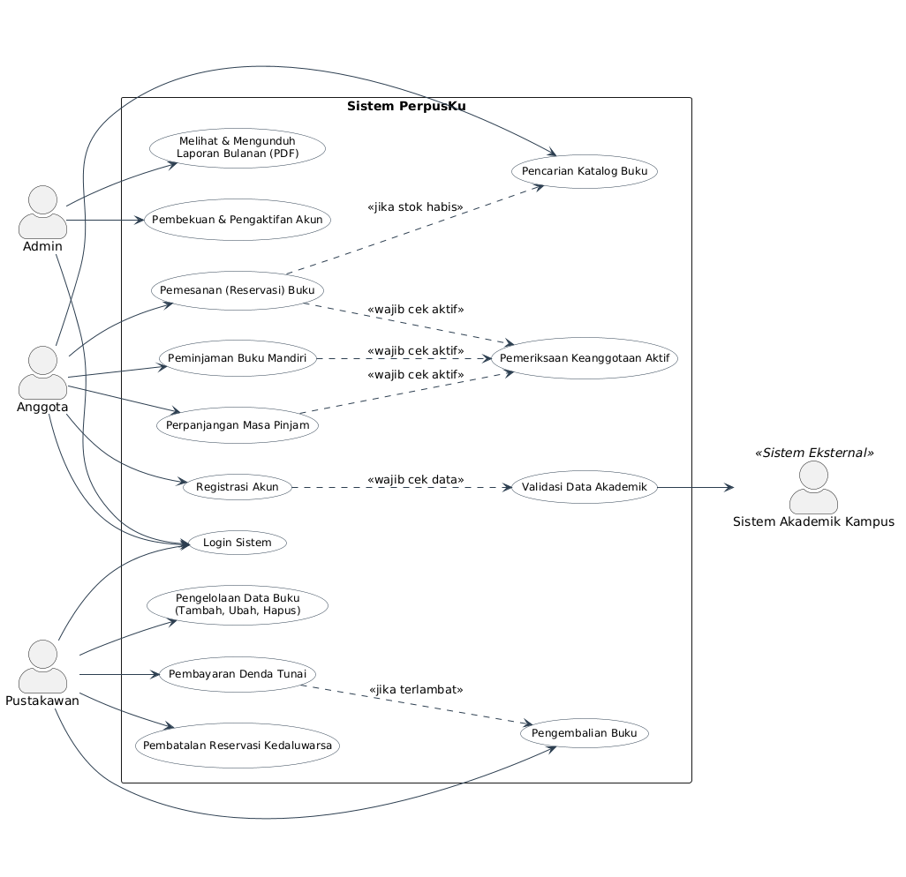
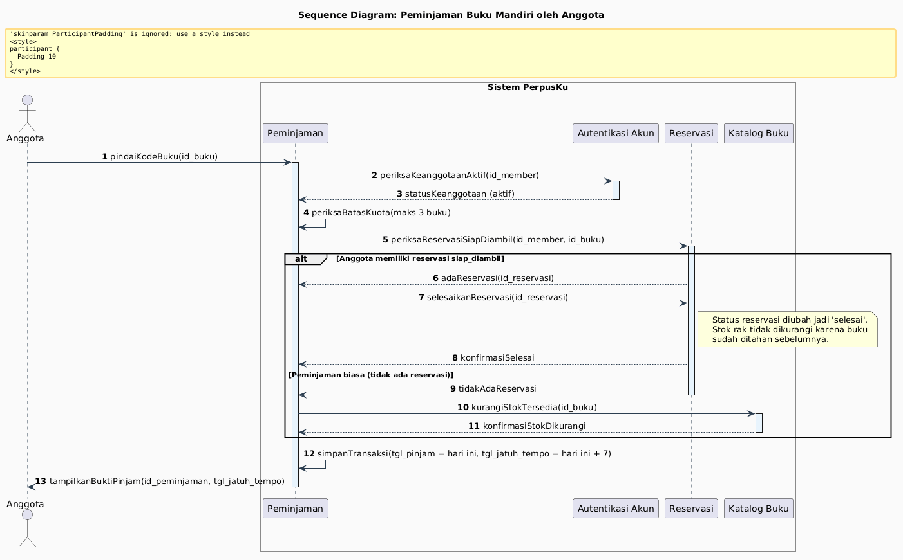
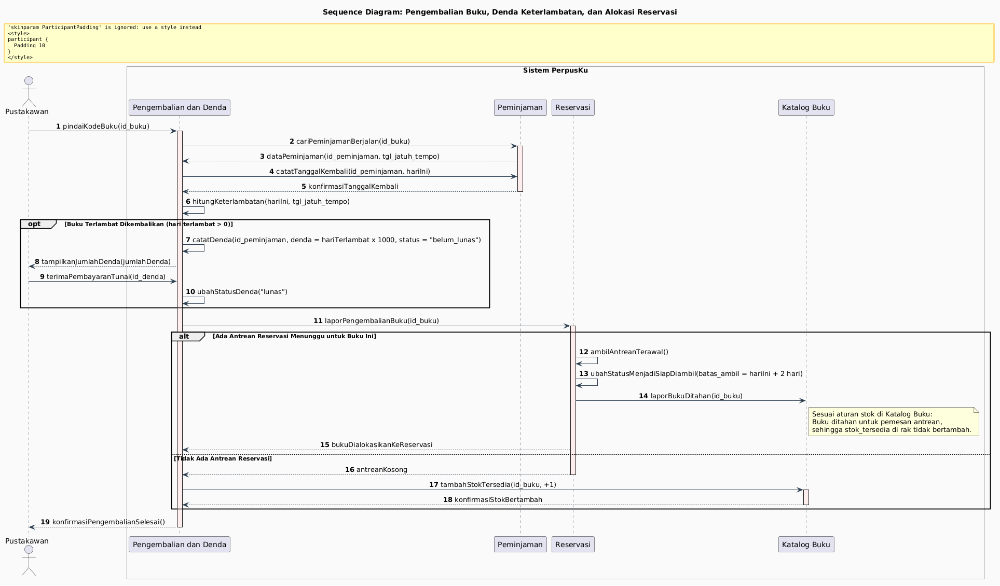

# Diagram Alur dan UML PerpusKu

Halaman ini mendokumentasikan diagram alur (*activity diagram*) dan diagram UML (*use case* serta *sequence diagram*) untuk sistem PerpusKu. Seluruh diagram dirancang menggunakan modul dan aktor yang telah dibakukan pada [Langkah 3: Modularisasi](../modules/README.md).

---

## 1. Diagram Alur (Activity Diagram)

### 1.1 Registrasi Akun dan Peminjaman Buku Mandiri

Diagram ini memodelkan proses awal calon anggota mendaftar hingga anggota melakukan peminjaman buku mandiri di kios atau ponsel. Alur memperlihatkan koordinasi antara aktor, pemeriksaan keanggotaan aktif, pengecekan kuota, hingga pembaruan stok atau penyelesaian reservasi.

*File PlantUML:* [`activity-registrasi-peminjaman.puml`](activity-registrasi-peminjaman.puml)

**Penjelasan Diagram:**
Diagram ini menggambarkan alur kerja registrasi anggota baru yang terintegrasi dengan data akademik kampus, dilanjutkan dengan alur peminjaman buku mandiri oleh anggota. Pada proses peminjaman, sistem melakukan verifikasi keanggotaan aktif melalui Modul Autentikasi Akun, validasi batas kuota pinjam (maksimal 3 buku) pada Modul Peminjaman, serta pengecekan ketersediaan buku baik dari antrean reservasi siap diambil maupun ketersediaan stok fisik di rak melalui Modul Katalog Buku. Seluruh proses berakhir pada pencatatan transaksi peminjaman selama 7 hari atau penghentian alur jika salah satu syarat validasi tidak terpenuhi.

---

### 1.2 Pengembalian Buku, Perhitungan Denda, dan Alokasi Reservasi

Diagram ini memodelkan proses saat buku dikembalikan ke meja layanan perpustakaan dan dipindai oleh pustakawan.

*File PlantUML:* [`activity-pengembalian-reservasi.puml`](activity-pengembalian-reservasi.puml)

**Penjelasan Diagram:**
Diagram ini memodelkan alur kerja pemrosesan pengembalian buku yang dilakukan oleh pustakawan melalui pemindaian kode buku pada Modul Pengembalian dan Denda. Jika pengembalian melewati tanggal jatuh tempo, sistem menghitung denda keterlambatan sebesar Rp1.000 per hari, mencatatnya dengan status belum lunas, dan pustakawan memproses pelunasannya secara tunai. Selanjutnya, sistem berkoordinasi dengan Modul Reservasi untuk memeriksa antrean pemesan; jika terdapat antrean, buku langsung ditahan selama 2 hari untuk pemesan terawal tanpa menambah stok rak, sedangkan jika antrean kosong, stok tersedia pada Modul Katalog Buku akan bertambah 1 eksemplar.

---

## 2. Diagram UML

### 2.1 Use Case Diagram

Diagram use case mendefinisikan batasan sistem PerpusKu, aktor yang berinteraksi, serta use case yang tersedia beserta relasi *include* dan *extend*.

*File PlantUML:* [`use-case.puml`](use-case.puml)

**Penjelasan Diagram:**
Diagram use case ini menggambarkan batas fungsionalitas Sistem PerpusKu yang melibatkan tiga aktor internal (Anggota, Pustakawan, dan Admin) serta satu aktor sistem eksternal (Sistem Akademik Kampus). Use case peminjaman, perpanjangan, dan pemesanan buku secara wajib menyertakan (`<<include>>`) pemeriksaan keanggotaan aktif untuk memastikan hak akses peminjam. Selain itu, use case pembayaran denda bertindak sebagai perluasan bersyarat (`<<extend>>`) terhadap use case pengembalian buku yang hanya dipicu saat terjadi keterlambatan pengembalian buku.

---

### 2.2 Sequence Diagram: Peminjaman Buku Mandiri

Diagram sequence ini menggambarkan kolaborasi pesan antar-modul saat anggota meminjam buku.

*File PlantUML:* [`sequence-peminjaman.puml`](sequence-peminjaman.puml)

**Penjelasan Diagram:**
Diagram ini mengilustrasikan urutan pertukaran pesan antar-modul saat seorang anggota melakukan transaksi peminjaman buku mandiri. Modul Peminjaman bertindak sebagai pengendali utama yang meminta verifikasi status keanggotaan aktif ke Modul Autentikasi Akun, mengecek batas kuota peminjaman, serta memvalidasi ketersediaan buku ke Modul Reservasi dan Modul Katalog Buku. Diagram ini juga memperlihatkan percabangan kondisi: jika buku berasal dari antrean reservasi siap diambil maka status reservasi diubah menjadi selesai tanpa mengurangi stok rak, sedangkan peminjaman biasa akan langsung mengurangi stok tersedia di katalog buku.

---

### 2.3 Sequence Diagram: Pengembalian Buku dan Denda

Diagram sequence ini menggambarkan urutan interaksi saat pustakawan memproses pengembalian buku fisik di meja sirkulasi.

*File PlantUML:* [`sequence-pengembalian.puml`](sequence-pengembalian.puml)

**Penjelasan Diagram:**
Diagram ini menggambarkan interaksi sekuensial saat pustakawan memproses pengembalian buku melalui Modul Pengembalian dan Denda. Modul secara otomatis mengambil data peminjaman berjalan dari Modul Peminjaman, mencatat tanggal kembali, dan mengeksekusi perhitungan denda jika terjadi keterlambatan sebelum menerima pembayaran tunai di meja layanan. Pada akhir proses, modul berkoordinasi dengan Modul Reservasi untuk mengalokasikan penahanan buku selama 2 hari bagi pemesan antrean terawal, atau memerintahkan Modul Katalog Buku menambah 1 stok rak jika tidak ada reservasi yang menunggu.

---

## 3. Matriks Keselarasan Modul Langkah 3 dan Partisipan Diagram

Untuk menjamin ketaatan pada pedoman langkah 4 dan 5, tabel berikut memetakan modul hasil modularisasi dengan perannya di dalam diagram:

| Modul (Langkah 3) | Muncul di Activity Diagram | Partisipan Sequence Diagram | Use Case Terkait |
|---|---|---|---|
| **Autentikasi Akun** | Partition / Lane | Partisipan `Auth` | Login, Registrasi, Pembekuan Akun, Pemeriksaan Keanggotaan Aktif |
| **Integrasi Akademik** | Partition / Lane | Digunakan via Autentikasi | Validasi Data Akademik (dengan Aktor Sistem Akademik) |
| **Katalog Buku** | Partition / Lane | Partisipan `Catalog` | Pencarian Katalog, Pengelolaan Data Buku, Pembaruan Stok |
| **Peminjaman** | Partition / Lane | Partisipan `Loan` | Peminjaman Mandiri, Perpanjangan Masa Pinjam |
| **Pengembalian dan Denda** | Partition / Lane | Partisipan `ReturnFine` | Pengembalian Buku, Pembayaran Denda Tunai |
| **Reservasi** | Partition / Lane | Partisipan `Resv` | Pemesanan Buku, Pembatalan Reservasi Kedaluwarsa, Alokasi Buku |
| **Laporan** | Disebutkan pada scope UML | Disebutkan pada use case | Melihat & Mengunduh Laporan Bulanan (PDF) |
